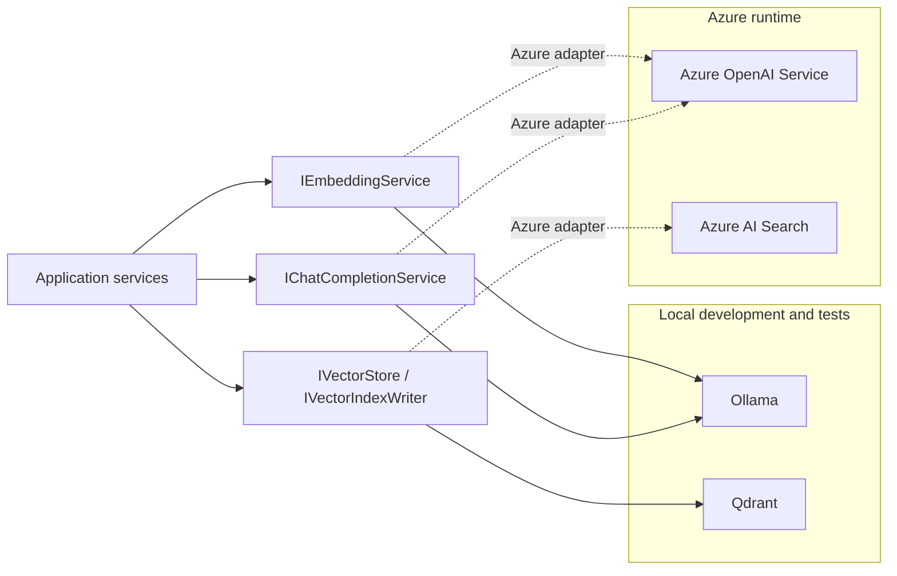
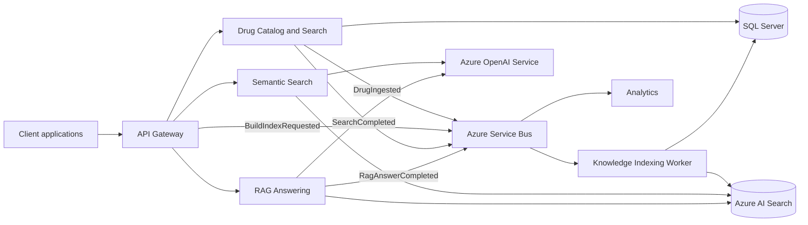

# DrugExplorer Microservices Architecture Diagrams

## 1. Runtime provider profiles



Qdrant and Ollama are local-only providers. Azure deployments will use Azure AI Search and Azure OpenAI Service. The current repository's dependency-injection registration selects Qdrant and Ollama from configuration; Azure provider adapters and registrations are planned. Application interfaces remain provider-neutral.

## 2. Target service and messaging view



Search and RAG remain synchronous HTTP requests where callers need immediate responses. Service Bus carries asynchronous indexing commands and events for downstream consumers such as Analytics.

## 3. Local test topology

```text
Local API / worker processes
├── SQL Server (local test database)
├── Ollama
│   ├── Embedding model
│   └── Chat model
└── Qdrant
    └── drug_chunks collection

Automated and integration tests run locally.
No live Azure AI Search or Azure OpenAI dependency is required by the test suite.
```

## 4. Azure deployment topology

```text
Azure
├── API Gateway and extracted services / workers
├── Azure Service Bus
├── Azure SQL Database
├── Azure AI Search
├── Azure OpenAI Service
├── Azure Key Vault / managed identities
└── Azure Monitor / Application Insights

Qdrant and Ollama are not deployed to Azure.
```

## 5. Migration sequence

```text
Current layered backend
        |
        v
Define provider-neutral interfaces and preserve API contracts
        |
        v
Extract indexing worker; use Qdrant/Ollama for local tests
        |
        v
Implement Azure AI Search and Azure OpenAI adapters
        |
        v
Extract catalog/search, semantic search, and RAG as justified
        |
        v
Shift Azure runtime to Azure providers; retain local providers for development
```

The Azure adapters and Azure Service Bus services are planned work and are not represented as currently implemented. Test suites remain local and should use local dependencies or test doubles rather than deployed Azure services.
